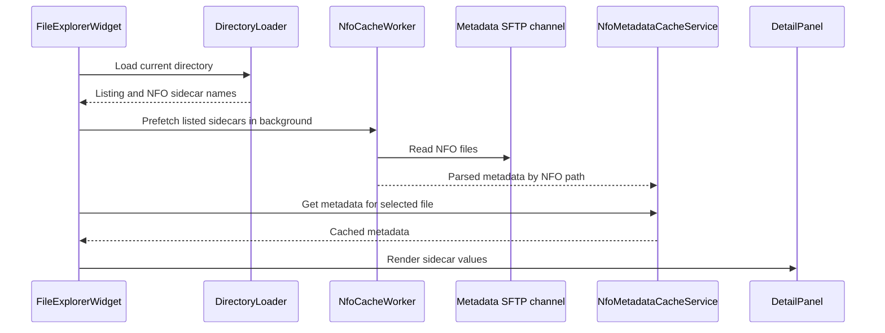
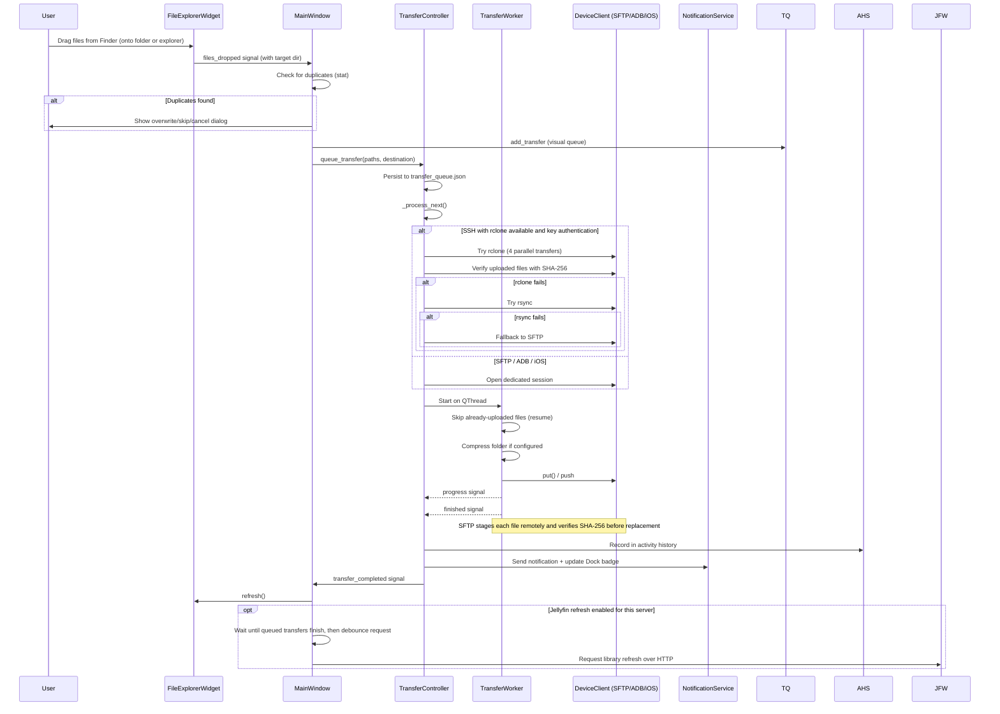
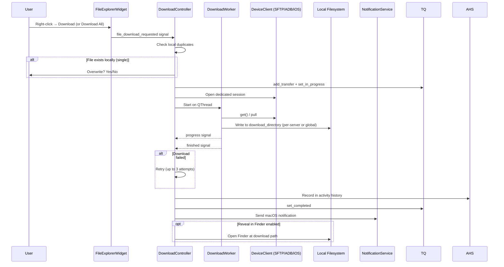
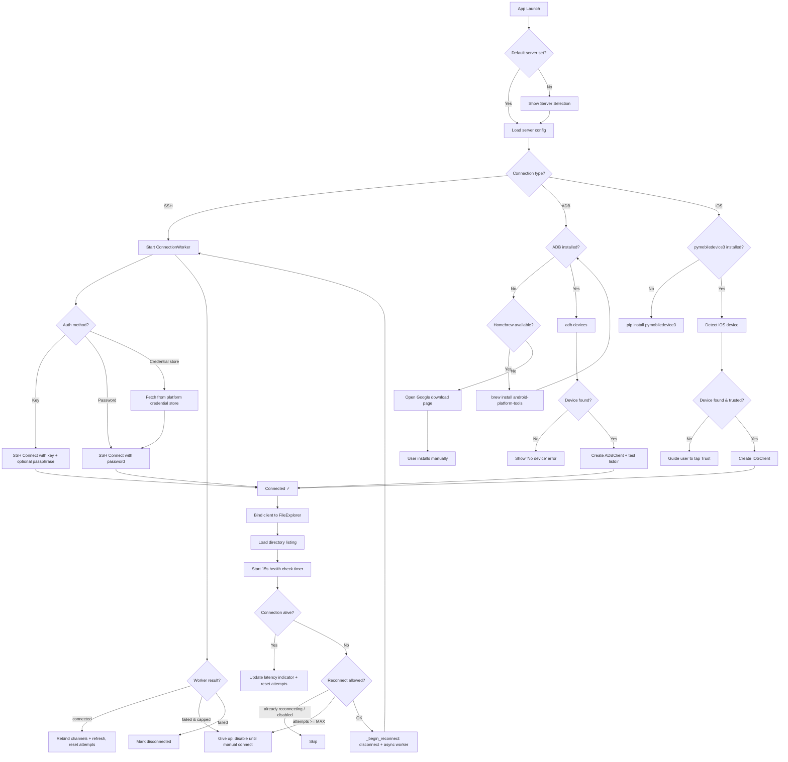
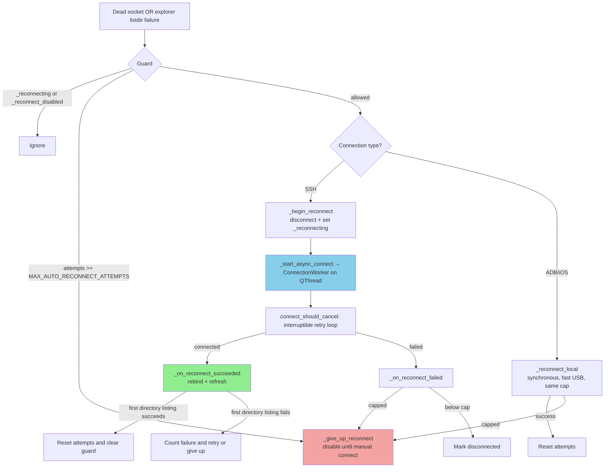
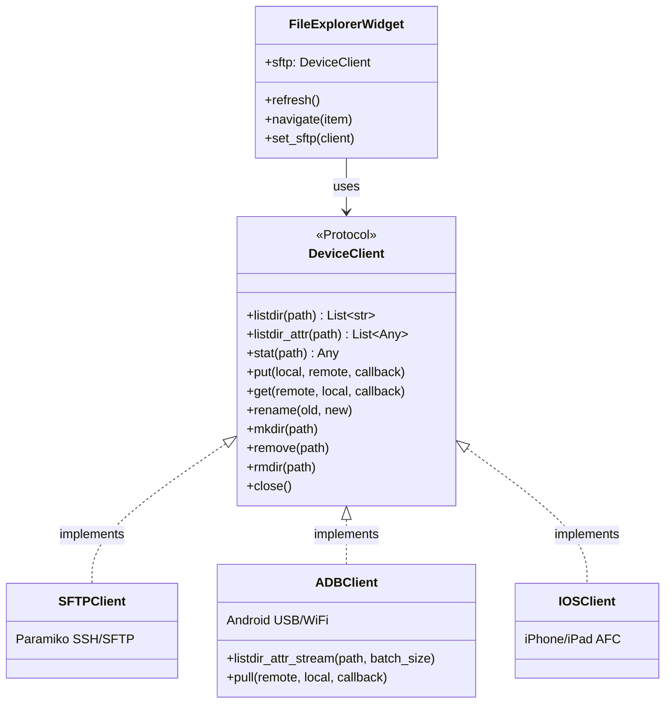
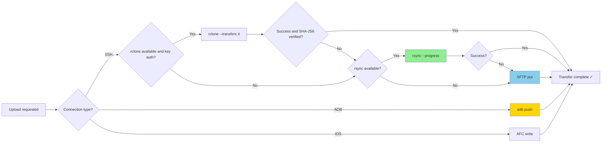
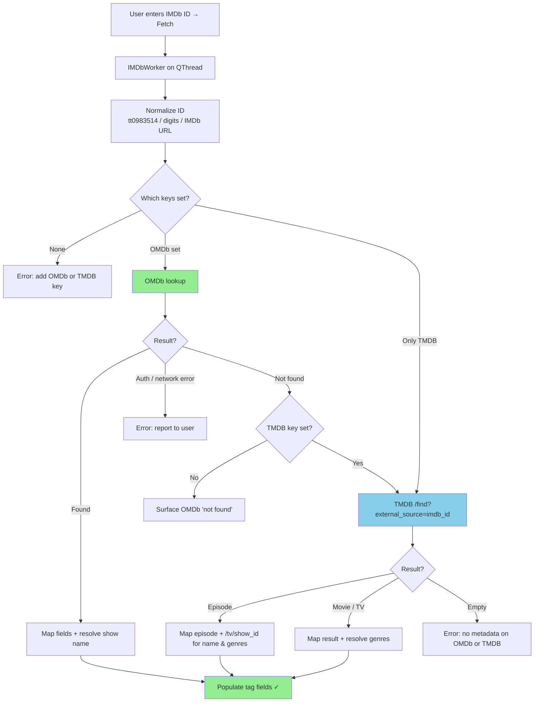
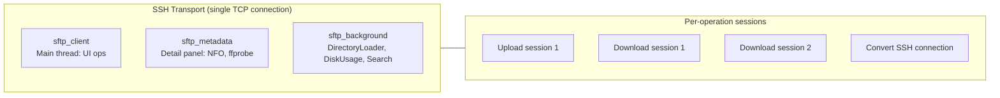

# System Diagram

> **Last updated:** November 2026: Version 3.8.0

## High-Level Architecture

```mermaid
graph TB
    subgraph UI["UI Layer (PySide6)"]
        MW[MainWindow]
        FE[FileExplorerWidget]
        TQ[TransferQueueWidget]
        DP[DetailPanel]
        BB[BookmarksBar]
        VCM[VideoConvertManager]
        SS[SettingsWindow]
    end

    subgraph Dialogs["Dialogs"]
        SSD[ServerSelectionDialog]
        BRD[BatchRenameDialog]
        BMD[BatchMetadataDialog]
        CSD[ConvertSettingsDialog]
        FPD[FolderPickerDialog]
        MID[MediaInfoDialog]
        QFD[QuickFixDialog]
        TSW[TrackSelectionWidget]
    end

    subgraph Controllers["Controller Layer"]
        MWC[MainWindowController]
        CC[ConnectionController]
        DC[DownloadController]
        FOC[FileOperationsController]
        MTC[MediaToolsController]
        TC[TransferController]
    end

    subgraph Workers["Background Threads (src/workers/)"]
        CW[ConnectionWorker]
        TW[TransferWorker]
        DW[DownloadWorker]
        DL[DirectoryLoader]
        NFW[NfoCacheWorker]
        SW[SearchWorker]
        DU[DiskUsageWorker]
        IW[IMDbWorker]
        JFW[JellyfinRefreshWorker]
        CVW[ConvertWorker]
        QFW[QuickFixWorker]
    end

    subgraph Clients["Device Clients (src/clients/)"]
        DC_PROTO[DeviceClient Protocol]
        ADB[ADBClient]
        IOS[IOSClient]
        SFTP[Paramiko SFTPClient]
        SSHCmd[SSH session helper]
    end

    subgraph Services["Service Layer"]
        CM[ConnectionManagerService]
        RFS[RemoteFileService]
        MFS[MediaFileService]
        FDS[FileDeletionService]
        BRS[BatchRenameService]
        AHS[ActivityHistoryService]
        NS[NotificationService]
        KS[KeychainService]
        RS[RsyncService]
        RCS[RcloneService]
        FF[FfmpegService]
        RMS[RemoteMediaService]
        NFC[NfoMetadataCacheService]
        TQS[TransferQueueService]
        SI[SleepInhibitorService]
        MB[MenuBarService]
        IS[IMDbService]
    end

    subgraph Repositories["Persistence Repositories"]
        SRepo[SettingsRepository]
        AHR[ActivityHistoryRepository]
        TQR[TransferQueueRepository]
    end

    subgraph MetadataAPIs["Metadata Providers (HTTP)"]
        OMDB[OMDb API]
        TMDB[TMDB API]
    end

    subgraph MediaServer["Media Server API"]
        Jellyfin[Jellyfin HTTP API]
    end

    subgraph Platform["Platform Layer (src/platform/)"]
        PM[macOS: Keychain, notifications, caffeinate, Finder]
        PW[Windows: credential manager, tray notifications, sleep control, Explorer]
    end

    subgraph External["External Systems"]
        SSH[SSH/SFTP Server]
        Android[Android Device USB/WiFi]
        iPhone[iOS Device USB]
        FS[Local Filesystem]
    end

    subgraph Config["Configuration & Storage"]
        Settings[Settings Singleton]
        JSON["~/.FileSling/config.json"]
        History["~/.FileSling/activity_history.json"]
        Queue["~/.FileSling/transfer_queue.json"]
        Errors["~/.FileSling/logs/errors.json"]
        Keychain["Operating system credential store"]
    end

    MW --> MWC
    MW --> FE
    MW --> TQ
    MW --> DP
    MW --> BB
    MWC --> CC
    MWC --> DC
    MWC --> FOC
    MWC --> MTC
    MWC --> TC
    FE --> MTC
    MWC --> NS
    CC --> CW
    CC --> CM
    TC --> TW
    TC --> TQS
    DC --> DW
    FE --> DL
    FE --> NFW
    FE --> NFC
    FE --> SW
    FE --> DU
    VCM --> FF
    MTC --> RMS
    QFD --> TSW
    NFW --> RMS
    NFW --> NFC
    MTC --> CVW
    MTC --> QFW
    MTC --> AHS
    BRD --> BRS
    BRS --> AHS
    BRS --> MFS
    AHS --> AHR
    TQS --> TQR
    RMS --> SSHCmd
    FF --> SSHCmd
    TW --> SSHCmd
    DU --> SSHCmd
    QFW --> SSHCmd
    Settings --> SRepo
    SRepo --> JSON
    AHR --> History
    TQR --> Queue
    MID --> IW
    IW --> IS
    IS --> OMDB
    IS --> TMDB
    MWC --> JFW
    JFW --> Jellyfin

    DC_PROTO <|.. SFTP
    DC_PROTO <|.. ADB
    DC_PROTO <|.. IOS

    CM --> SSH
    ADB --> Android
    IOS --> iPhone
    FDS --> FS
    AHS --> History
    KS --> Keychain
    RS --> SSH
    RCS --> SSH
    Settings --> JSON
    TC --> Queue

    TW --> SFTP
    TW --> ADB
    TW --> IOS
    DW --> SFTP
    DW --> ADB
    DW --> IOS
    DL --> SFTP
    DL --> ADB
    DL --> IOS
    NFW --> SFTP
```

## NFO Cache Flow



## Upload Flow



## Download Flow



## Connection Flow



## Auto-Reconnect (bounded, off the UI thread)



## Backend Abstraction



## Transfer Method Selection



## IMDb Metadata Fetch Flow



## SFTP Channel Architecture


